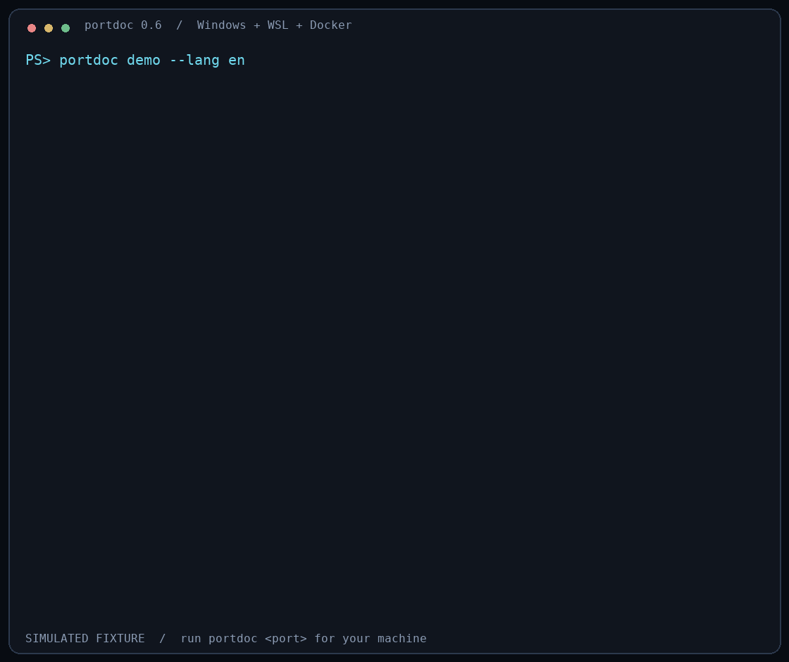

# portdoc

**localhost fails, but 127.0.0.1 works? See the difference across Windows and WSL.**

Compare IPv4, IPv6 and localhost TCP connections. See the listening process,
its project path, and Docker Compose service in the same report.
Discover listening ports first with `portdoc scan`, then inspect a specific
port, including Windows excluded TCP ranges.

[简体中文](README.zh-CN.md) · [Download Windows EXE](https://github.com/nisconder/portdoc/releases/latest) · [npm](https://www.npmjs.com/package/portdoc)



*An explicitly labeled, reproducible sample. Run `portdoc demo` to see the same
report without inspecting your machine.*

```powershell
portdoc doctor
portdoc scan
portdoc 5173
```

Windows · WSL2 · Docker Desktop · TCP · read-only

`doctor` checks collector availability without starting WSL or Docker.
`scan` lists observed listeners and mappings without opening TCP connections.
`portdoc <port>` then checks endpoint reachability and Windows exclusions.

## Install on Windows

### Standalone EXE — no Node.js needed

1. Download [portdoc-win-x64.zip](https://github.com/nisconder/portdoc/releases/latest/download/portdoc-win-x64.zip).
2. Extract the ZIP and open Windows PowerShell or CMD in that folder.
3. Run:

```powershell
.\portdoc.exe
.\portdoc.exe demo
.\portdoc.exe 5173
```

The EXE is unsigned and bundles the Node runtime. The release includes
`SHA256SUMS.txt`; `Get-FileHash .\portdoc.exe -Algorithm SHA256` matches the
`portdoc-win-x64.exe` checksum (the ZIP contains the same file under a short name).
Add its folder to PATH if you want to use `portdoc` from anywhere.

### npm — if Node.js is already installed on Windows

In **Windows PowerShell or CMD**, with Node.js 18 or newer:

```powershell
npm install --global portdoc@latest
portdoc --version
portdoc
portdoc 5173
```

`portdoc` alone displays the complete help screen. `npm i portdoc` is a
project-local install and does not put the command on your global PATH.
Run the Windows application from Windows; installing it inside WSL is not supported.

Try it once without a global install:

```powershell
npx --yes portdoc@latest 5173
```

If an npm mirror has not synchronized the release, use the official Registry
for this command only:

```powershell
npm install --global portdoc@latest --registry=https://registry.npmjs.org/
```

## What you learn

| Question | Evidence |
| --- | --- |
| Does localhost behave differently? | Windows and WSL each test `localhost`, `127.0.0.1`, and `::1` |
| Which address did localhost select? | First resolved address and address family; no fallback |
| Which project is listening? | Windows PID, executable and command line; WSL `/proc` command line and cwd |
| Which container publishes it? | Docker host/container ports, image, Compose project, service and path |
| Which ports should I inspect? | One inventory per layer, grouped by port; potential overlaps highlighted |
| Why can a listener-free port still reject a bind? | Matching active Windows IPv4/IPv6 excluded TCP ranges |
| What can I try next? | Findings, reachable literal address and a copyable verification command |

Windows project paths are inferred only from absolute script arguments and
labeled as inferred. Windows cwd is unavailable. WSL `/proc` details require
permission to read the listener's process and Python 3; basic `ss` evidence
still works without them. Docker Compose information depends on its labels.

WSL and Docker are optional, but an inaccessible source is incomplete evidence.
The report shows which checks succeeded and lowers confidence rather than
calling an uninspected port free. No elevation is requested by the application.

## Discover ports and check the environment

```powershell
portdoc scan                         # Default: first 30 observed TCP ports
portdoc scan --issues-only           # Potential cross-layer overlap
portdoc scan --limit 100 --json       # Larger machine-readable inventory
portdoc scan --distro Ubuntu         # Inventory one selected WSL distribution
portdoc doctor                       # Windows, registered WSL and local Docker
portdoc scan --help
portdoc doctor --help
```

Scan enumerates listener tables and container mappings once per layer. It does
not connect to each port or probe all 65,535 possibilities. `--limit` ranges
from 1 to 500 and also limits JSON `ports`; `totalPorts`, `overlapCount` and
`truncated` describe the full matching inventory before that display limit.
JSON `sources` retains the original observed evidence. Known Docker/WSL
forwarders are distinguished from independent listener claims.

Potential overlap needs review and is not confirmed misrouting. Scan exits
with 1 when any matching port may overlap, including beyond the displayed
limit; otherwise 2 for incomplete inspection, or 0 for a complete inventory.
It does not check reserved ranges or reachability; inspect an individual port
for those checks. Querying the selected/default WSL distribution can start it.

Doctor only lists registered WSL distributions, without starting them. It
checks Windows listener-query availability and the local Docker Engine.
Its exit code is 0 when Windows inspection is ready, even if optional
WSL/Docker checks need attention; otherwise 2. Guest `ss`, Python and `nc`
availability is checked during a specific port diagnosis.

Docker queries use the local `docker_engine` or `dockerDesktopLinuxEngine`
named pipe. Remote `DOCKER_HOST` / Docker contexts are not mixed into local
port reports; saved Docker configuration is unchanged.

## Windows excluded ranges

`portdoc 50000` also runs the read-only `netsh interface ipv4/ipv6 show
excludedportrange protocol=tcp` queries. The report shows matching bounds and
the `*` administered marker. If no listener exists but a range contains the
port, the verdict is `UNKNOWN` with the matching evidence instead of `FREE`.

A matching range may restrict a new bind depending on the API and permissions;
it is not proof that binding must fail or that a process occupies the port.
An existing listener inside an exclusion is not automatically a conflict.
Failed exclusion checks stay explicit and do not erase successful results.

Verification suggestions now reference actual PIDs, the selected WSL
distribution, container IDs and matching exclusion families. They are read-only
PowerShell commands; portdoc does not execute those suggestions. When a long
command wraps in a narrow terminal, use the `nextActions` JSON field for the
complete command string.

## Examples

```powershell
portdoc                         # Full help
portdoc scan                    # Discover observed ports
portdoc doctor                  # Check local collector availability
portdoc demo                    # Offline simulated example
portdoc 8080 --distro Ubuntu     # Select a WSL distribution
portdoc 5173 --lang zh-CN        # Simplified Chinese
portdoc 5173 --lang en           # English
portdoc 5432 --no-probe          # Ownership only; no TCP connections
portdoc 5173 --json              # Language-neutral diagnosis, schemaVersion 3
portdoc 5173 --timeout 10000     # Allow slower collectors ten seconds
```

Any TCP port from `1` to `65535` is valid; `5173` is an example, not a default.
`--docker-path <file>` selects a Docker CLI explicitly. Docker Desktop's
standard Windows install locations are searched when Docker is absent from PATH.
Use `--no-color` or `NO_COLOR=1` for plain output. `PORTDOC_LANG=zh-CN` sets
the language preference; otherwise the interface follows the system locale.

## Understand the result

| Verdict | Exit | Meaning |
| --- | ---: | --- |
| `FREE` | 0 | All collectors completed, no owner and no reachable endpoint were found |
| `OK` | 0 | An owner was found and no actionable issue was observed |
| `CONFLICT` | 1 | Potential cross-layer overlap; review whether listeners belong to the same service |
| `UNKNOWN` | 2 | Incomplete evidence, localhost/literal mismatch, or no listener but an exclusion matches |

An IPv4-only server can be intentional. The matrix shows the difference;
it does not prove a broken WSL relay. The `localhost` probe uses the first
resolved address without automatic fallback. Browsers and other applications
may select a different address or retry another family.

TCP success proves reachability, not which application accepted the connection.
Cross-layer listeners can be expected forwarding or independent namespaces.
portdoc does not claim to identify the final receiver, send HTTP payloads,
terminate observed listeners, change networking, or upload reports.
Timed-out collector commands started by portdoc are terminated on a best-effort
basis: Windows uses `taskkill /T /F`, and POSIX uses a private process group.
Cleanup has a separate 250 ms deadline, after which portdoc closes its pipes,
stops waiting on child handles and marks the command as timed out.
Scheduling can add latency.
Escaped descendants and processes inside WSL are not guaranteed to be terminated.

Common credential-like arguments are redacted before display and JSON output.
Command lines and local paths can still contain private information; review
reports before sharing them.

The diagnosis JSON contract is [schema/report.schema.json](schema/report.schema.json)
(v3, `kind: diagnosis`), with `reservations` and `nextActions`. Legacy
`probes.windows` / `probes.wsl` remain IPv4 aliases. Inventory and environment
reports have their own [scan](schema/scan.schema.json) and
[doctor](schema/doctor.schema.json) v1 contracts, distinguished by `kind`.
Frozen [v1](schema/report-v1.schema.json) and [v2](schema/report-v2.schema.json)
schemas document 0.5.x and 0.6.x diagnosis reports.

## Development

No npm runtime or development dependencies:

```powershell
node --test
node --check bin/portdoc.js
node scripts/build-exe.mjs
```

The EXE build downloads an official, pinned Node runtime and verifies its
SHA-256 before embedding the original modules using Node SEA. See
[build instructions](docs/build.md). CI is configured for Node 20, 22 and 24
on Windows and Linux.
Linux tests cover command timeout behavior; they do not establish Windows/WSL/Docker
diagnostic correctness. See [reproducible validation cases](docs/validation.md)
for the real-environment evidence checklist and unverified scenarios.

In a checkout, `portdoc.cmd` forwards command-line arguments and shows help
when called alone. Double-click `portdoc-launcher.cmd` for a port prompt.

Not yet included: active full-range port probing, HTTP service fingerprinting,
network mode detection, automated fixes, UDP, Podman
and WSL Containers (`wslc`).

## License

[MIT](LICENSE). The standalone ZIP also includes the bundled Node runtime's license.

