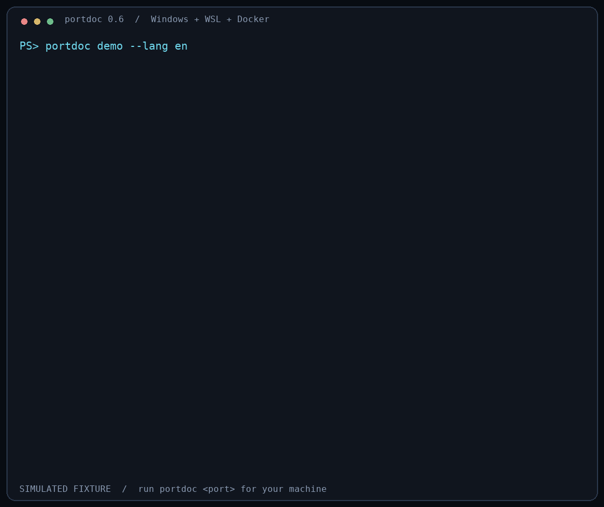

# portdoc

**localhost 连不上，但 127.0.0.1 能连接？一张表看清 Windows 和 WSL 的差异。**

同时对比 IPv4、IPv6 和 localhost 的 TCP 连接结果，并显示监听进程、
项目路径和 Docker Compose 服务。

[English](README.md) · [下载 Windows 独立版](https://github.com/nisconder/portdoc/releases/latest) · [npm](https://www.npmjs.com/package/portdoc)



动图为明确标注的模拟样例。运行 `portdoc demo --lang zh-CN` 可查看中文样例，
不会检查当前机器。

## 安装

### Windows 独立 EXE（无需 Node.js）

1. 下载 [portdoc-win-x64.zip](https://github.com/nisconder/portdoc/releases/latest/download/portdoc-win-x64.zip)。
2. 解压后，在该文件夹打开 Windows PowerShell 或 CMD。
3. 运行：

```powershell
.\portdoc.exe
.\portdoc.exe demo --lang zh-CN
.\portdoc.exe 5173
```

单独运行会打开帮助。把文件夹加入 PATH 后，可在其他目录直接运行 `portdoc`。
独立版尚未签名，发布页提供 SHA-256 校验和；ZIP 内的 `portdoc.exe` 与
独立下载的 `portdoc-win-x64.exe` 内容相同。可运行
`Get-FileHash .\portdoc.exe -Algorithm SHA256` 核对。

### npm（已在 Windows 安装 Node.js 的用户）

需要 Node.js 18 或更高版本，请在 **Windows PowerShell 或 CMD** 运行：

```powershell
npm install --global portdoc@latest
portdoc --version
portdoc
portdoc 5173
```

`npm i portdoc` 是项目局部安装，不会把命令加入全局 PATH。当前工具需要从
Windows 访问 Windows、WSL 和 Docker，暂不支持安装在 WSL 内运行。

免全局安装运行：

```powershell
npx --yes portdoc@latest 5173
```

镜像尚未同步时，仅对本次安装使用官方源，不改全局配置：

```powershell
npm install --global portdoc@latest --registry=https://registry.npmjs.org/
```

## 能解决什么问题

- 对比 Windows、WSL 两侧的 `localhost`、`127.0.0.1`、`::1` 是否可以连接。
- 显示 localhost 实际采用的首选解析地址，解释地址族差异。
- Windows 显示 PID、程序和脱敏命令行；有绝对脚本路径时推断项目目录。
- WSL 读取 `/proc` 获取实际工作目录、可执行文件和命令行。
- Docker 显示映射端口、镜像及 Compose 项目、服务、目录标签。
- 根据证据给出下一步检查建议和可复制的验证命令。

Windows 无法读取实际工作目录，推断路径会明确标注。WSL 详细身份信息需要
Python 3 和进程访问权限，缺少时仍保留基本 `ss` 监听证据。
Docker Compose 信息取决于容器标签。

## 常用命令

```powershell
portdoc                             # 完整帮助
portdoc demo --lang zh-CN            # 离线模拟样例
portdoc 8080 --distro Ubuntu         # 指定 WSL 发行版
portdoc 5173 --lang zh-CN            # 中文
portdoc 5173 --lang en               # 英文
portdoc 5432 --no-probe              # 仅采集归属，不发起 TCP 连接
portdoc 5173 --json                  # 语言无关 JSON，schemaVersion 2
```

端口可取 `1` 到 `65535`；`5173` 只是示例。默认跟随系统语言，可用
`$env:PORTDOC_LANG = "zh-CN"` 设置当前 PowerShell 会话偏好。

## 结果边界

| 结果 | 退出码 | 含义 |
| --- | ---: | --- |
| FREE | 0 | 所有采集完成，未发现监听、映射或可连接端点 |
| OK | 0 | 发现归属，未观察到需要处理的异常 |
| CONFLICT | 1 | 多层可能重叠，需要核对是否属于同一服务 |
| UNKNOWN | 2 | 部分检查未完成，或 localhost 失败而直接地址可达 |

服务只绑定 IPv4 可能是正常配置。localhost 仅测试首选解析地址，不自动回退；
浏览器的选择可能不同。TCP 可以连接也不能证明哪个应用最终接收了连接。
WSL 或 Docker 无法检查时，不会把未检查的端口冒报为空闲。

工具只读运行，不会结束进程、修改网络或上传报告。常见密钥参数会脱敏，
但路径和命令行仍可能包含私人信息，分享前请复查。

本版尚未包含：全端口扫描、HTTP 指纹、网络模式识别、Windows 保留端口检查、
自动修复、UDP、Podman 和 `wslc`。

开发与 EXE 构建请参阅 [英文说明](README.md#development) 和
[构建文档](docs/build.md)。许可证：[MIT](LICENSE)。
